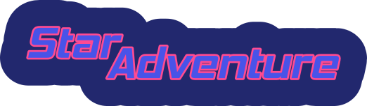

# Star Adventure

[](https://godotengine.org/)
[](https://opensource.org/licenses/MIT)
[](https://github.com/TopScales/star_adventure/actions)

**Star Adventure** is a fast-paced mobile *shoot ’em up* inspired by Space Invaders, designed for short, intense play sessions. Players pilot a spacecraft through escalating waves of enemies and environmental hazards, relying on positioning, momentum, and spatial awareness that combined with custom ship designs provide a game experience that can fit different play styles.

<p align="center">
  
</p>

*Move smart. Survive longer.*

## 🛠️ Getting Started

To begin working on this project, follow the steps below:

- Clone the project `git clone git@github.com:TopScales/star_adventure.git`
- Update all submodules `git submodule update --init`
- Copy the content of the `misc/vscode` folder into a new `.vscode` folder
- Compile the editor using one of the available VSCode tasks: press <kbd>Ctrl</kbd>+<kbd>Shift</kbd>+<kbd>B</kbd> and select `Build Custom Editor` or `Build Custom Editor (DEBUG)`
- Run the editor from VScode via **Run and Debug** in the activity bar, then press the play button.

## 🖼️ Overview

To keep the project organized, different types of files are stored in dedicated folders. The project follows the structure illustrated below.


```{.yaml .no-copy}
root/
│
├── addons/             # Addons and tools used for the project
├── assets/
│   ├── fonts/          # Fonts used for the game
│   ├── gui/            # Themes and images used for GUI elements
│   ├── icons/
│   │   ├── classes/    # Editor-only class icons
│   │   └── system/     # System icons used in the game
│   ├── logo/           # Logo of the game
│   ├── textures/       # Textures and images
│   └── sounds/         # Sound assets
├── data/               # Game data
├── docs/               # Documentation
├── godot/
│   ├── modules/        # C++ Godot modules
│   └── source/         # Godot editor source code
├── misc/               # Miscellaneous files (e.g., VSCode-specific files)
├── scenes/             # Game scenes and scripts
├── tests/              # Scenes and scripts for testing various modules
├── CREDITS             # Credits information of assets and contributors
├── LICENSE             # License file
├── mkdocs.yml          # MkDocs configuration
├── project.godot       # Godot project file
├── README.md           # Project README
└── version.tres        # Version file
```

### Scenes and Assets

Scenes and assets should not be stored in the same folders. Each has its own dedicated structure. Keeping them separate helps in avoiding cluttering and makes assets easier to reuse across multiple scenes.

### Documentation

All documentation related to the game and its development is stored in the `docs` folder. See the [index file](docs/index.md) for instructions on how to generate the documentation locally or where to access it online.

## 🤝 Guidelines

Please follow these guidelines while working on the project. Having consistent naming conventions and code style helps maintain clarity and improves collaboration.

Use *snake_case* for all file and folder names. Avoid using whitespace. This ensures clarity and prevents cross-platform issues related to case sensitivity.

For GDScript, follow the official [style guide](https://docs.godotengine.org/en/latest/tutorials/scripting/gdscript/gdscript_styleguide.html).
For C++ modules and libraries, follow Godot’s [code style](https://contributing.godotengine.org/en/latest/engine/guidelines/code_style.html)
(third-party libraries may use their own style conventions).

During development, regularly test the modules you are working on to maintain quality.
For GDScript modules, use [GUT](https://gut.readthedocs.io/en/v9.5.0/) for unit testing.
For C++ modules, create [unit tests](https://docs.godotengine.org/en/stable/engine_details/architecture/unit_testing.html) following Godot’s documentation.

## 🛎️ Support

For any question related to the project contact the corresponding area manager.

- **Project Lead**: Rafael M. Gordillo [](https://discord.com/users/419045373194141696/)
- **Programming Lead**: Rafael M. Gordillo [](https://discord.com/users/419045373194141696/)
- **Game Design Lead**: Rafael M. Gordillo [](https://discord.com/users/419045373194141696/)
- **Art Lead**: Rafael M. Gordillo [](https://discord.com/users/419045373194141696/)

## 🚀 Deploying the game

>📝 **NOTE:** Add instructions on how to deploy the game for testing. It is usually better to link to separate documents.

*This section can be completed later.*

## 🪪 License

Distributed under the [MIT license](https://opensource.org/license/MIT).
